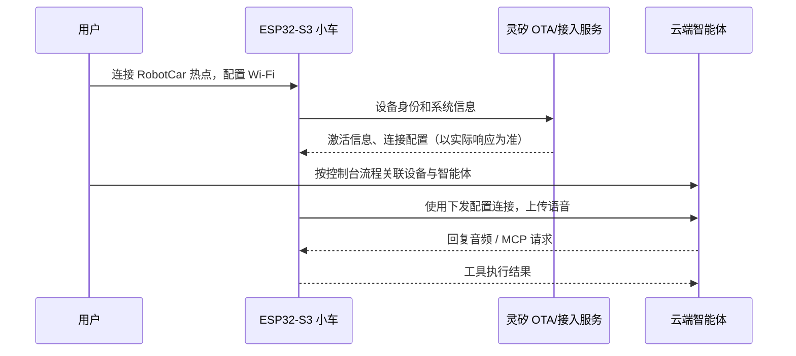

# 灵矽接入与到货后的首轮验证

## 本次做到哪里

本步骤为固件预置灵矽公开 OTA 入口 `https://xrobo.qiniuapi.com/v1/ota/`，增加 OTA 配置来源日志，并整理配网、设备绑定和语音/MCP 验证流程。板型、屏幕和接线沿用第二步的小车配置；该接入步骤当时尚未导入底盘控制修正和炮塔；后续实现状态分别见 [底盘](chassis-control.md) 和 [炮塔](turret-control.md)。没有代替你创建云端账号、智能体或设备。

2026-10-26 对 [灵矽控制台](https://linx.qiniu.com/) 和公开 OTA 入口进行不带设备标识的 GET 检查，两者均返回 HTTP 200。OTA GET 返回服务健康文本，**不是设备握手 JSON**；这不能证明激活、设备类型识别、凭据下发、MCP 或语音链路已经通过。

## 设备与云端如何配合



这里的 OTA 入口兼有设备接入作用，不只是下载固件。`ota.cc` 使用设备 Wi-Fi STA MAC 作为 `Device-Id`，使用保存在 NVS 的 UUID 作为 `Client-Id`，提交系统信息。返回值中若有 `activation` 则进入激活流程；`mqtt` 和 `websocket` 中的连接参数会保存到对应 NVS 命名空间。

`Application::InitializeProtocol()` 在响应同时包含两种配置时优先选择 MQTT，否则选择 WebSocket；若都没有则仍尝试 MQTT，因此单看“Activation done”不能证明语音连接成功。WebSocket 从设备配置读取 URL/token，MQTT 读取 endpoint/client_id/username/password。云端是否返回兼容字段仍需设备联调确认。

本步骤没有新增灵矽专用协议适配器，复用 codebase 的兼容接入流程；云端若返回不同结构，需要根据真实响应补充适配，不能仅通过替换入口地址宣称接入完成。

固件仍支持服务端通知更新，收到较新版本或强制更新配置时会进入升级流程。首次联调前应核对平台为 `intelligent-car` 返回的固件策略，避免演示版被其他板型固件覆盖。不要伪造设备 MAC 或用随机设备身份测试注册接口。

## 硬件到货前可以完成

1. 登录控制台，创建比赛用智能体，准备名称、音色和 [接入阶段提示词](agent-prompt.md)。具体入口名称以你有权限访问的当前控制台为准。
2. 确认账号具备接入设备、绑定智能体及使用模型/语音的权限与额度，记录负责人或比赛提供的接入方式。
3. 准备能访问云端的 2.4GHz Wi-Fi。此阶段不用把 Wi-Fi 密码、云端 token 或 API Key 填进源码。
4. 执行 `./tools/build.sh`，确认生成配置中的 OTA 地址已经更新；已有配置的迁移方法见下节。
5. 准备接线、串口工具和下面的验收清单。设备 MAC 必须等实物到手读取；现在不能宣称设备已绑定或语音已通过。

## 两层配置优先级

| 层级 | 位置 | 影响 |
| --- | --- | --- |
| 构建时有效配置 | 本机 `firmware/sdkconfig` | 优先于 defaults，旧文件不会因修改 defaults 自动更新 |
| 设备运行时覆盖 | NVS 的 `wifi/ota_url` | 非空时优先于编入固件的 `CONFIG_OTA_URL`，重新烧录通常仍保留 |

本 PR 将 Kconfig 默认值和 `tools/sdkconfig.defaults.car` 都设为灵矽入口。已有旧 `sdkconfig` 时，按 [构建说明](build.md#配置与排错) 备份配置与构建目录，再构建；或者在 `./tools/build.sh menuconfig` 的 `Intelligent Robot Car → Default OTA URL` 修改本机有效值。核对：

```bash
rg '^CONFIG_OTA_URL=' firmware/sdkconfig
```

设备启动检查接入配置时会打印 `OTA endpoint source: firmware default (CONFIG_OTA_URL)` 或 `device override (wifi/ota_url)`，同时打印板型与 Wi-Fi STA MAC 供设备绑定核对。如果设备覆盖地址不同于固件默认值，还会出现迁移提醒；新增日志不打印该 URL。当前其他继承日志仍可能包含会话、网络或激活信息，分享日志前需自行脱敏。

旧设备若仍连接原平台，在**配网页面 → 高级配置**的自定义 OTA URL 中填入灵矽入口并保存重启，或将该字段清空并保存以恢复固件默认值。该页面来自固定版本的配网组件，支持保存 `wifi/ota_url`。当前板级代码在启动 `Starting` 状态时点击 BOOT 可进入配网；已连接后的同一按钮用于切换对话，不要套用其他固件的长按教程，实际按键时序需到货验证。本步骤不自动覆盖 NVS，不执行全片擦除，避免丢失 Wi-Fi、UUID 和其他设备设置。

## 到货后按层验证

先只连接 ESP32、麦克风、功放和屏幕，断开电机及发射机构动力。当前底盘已关闭聊天/情绪触发的自动移动，但显式运动工具仍可驱动车轮。首轮语音验证保持断开动力，不能把提示词当作设备隔离。

| 外设 | 当前代码引脚 | 需要核对 |
| --- | --- | --- |
| INMP441 麦克风 | WS=4、SCK=5、DIN=6 | 电压、左右声道选择和模块引脚命名 |
| MAX98357A 功放 | DOUT=7、BCLK=15、LRCK=16 | 模块供电和喇叭额定参数 |
| SSD1306 128×64 | SDA=41、SCL=42 | I²C 地址、供电与接线方向 |
| 两轮电机驱动（后续验证） | 左正=12、左反=13、右正=14、右反=21 | 实际驱动模块、逻辑电平与供电 |

以上来自 `firmware/main/boards/intelligent-car/config.h`，不代表已核验采购实物。先按模块资料核对供电和共地，再使用显式串口运行：

```bash
CAR_PORT=/dev/cu.usbmodemXXXX ./tools/build.sh flash
```

用实际串口替换示例；退出日志按 Ctrl+]。依次记录：

- [ ] 稳定启动，屏幕和音频外设初始化正常；能确认目标是 `intelligent-car`。
- [ ] 连接 `RobotCar-` 前缀热点，打开 `http://192.168.4.1`，配置实际 Wi-Fi；日志出现 `Network connected`。
- [ ] OTA 来源符合预期，HTTP 请求成功；若非 200，先记录状态码和时间，不先更改协议或擦除设备。
- [ ] 从设备日志/平台识别信息核对 **Wi-Fi STA MAC**，按当前控制台流程导入/关联设备并绑定智能体。若平台使用激活码则跟随屏幕和语音提示；控制台是否要求批量导入由实际账号界面确定。
- [ ] 云端接受 `intelligent-car` 类型，返回连接参数；根据日志确认实际选择 MQTT 还是 WebSocket，排除缺少配置的回退情况。
- [ ] 使用当前模型默认唤醒词“你好小智”，确认识别文本、回复文本和喇叭音频各自正常。
- [ ] 请求“查询设备状态”，确认实际收到 `self.get_device_status` 的 MCP 调用与结果。只有模型口头回答不算工具链路通过。

只记录通过的层级。尚未配置外设、没有工具调用、能显示文本但没有音频等情况，都应保留为未通过项。电机、失联停车和炮塔使用后续模块的验收流程。

## 排错顺序

| 现象 | 先查什么 |
| --- | --- |
| 没有串口输出或反复复位 | 数据线、串口、板型、PSRAM 与供电；暂不归因云端 |
| 没有连接 Wi-Fi | 2.4GHz、SSID/密码、热点/配网状态；不要公开密码 |
| 刷机后仍连旧平台 | 先查构建配置，再查 `wifi/ota_url` 覆盖来源 |
| 激活/版本检查持续重试 | HTTP 状态、平台接入权限、设备身份和板型识别；当前上游重试退避较长 |
| 没有连接参数 | 核对云端响应是否包含兼容 `mqtt`/`websocket` 字段；`No protocol specified` 不是成功 |
| 有文字但没有回复音频 | 协议音频、采样率、功放接线/供电/音量，分别核对 |
| 能聊天但工具不执行 | 核对 MCP 初始化、工具列表、调用名、参数和结果；“Add tool”仅代表本地注册 |
| 激活未完成时打不开遥控网页 | 当前网页服务在激活完成事件后启动，不是冷启动离线替代入口 |

不要仅凭症状认定“没绑定”或“加电容就好”。保存脱敏后的分层证据，再决定修改哪一层。

## 第三步验证记录（2026-10-26）

- ESP-IDF v5.5.1、macOS，从新生成的有效配置和构建目录完成完整编译与链接；`intelligent_robot_car.bin` 为 2,707,680 字节，应用分区剩余约 34%。
- Kconfig 默认值、工程预设、生成的 `sdkconfig` 和编译使用的 `config/sdkconfig.h` 中 OTA 地址一致，板型与 128×64 屏幕配置正确。
- 控制台和公开 OTA 入口的无身份 GET 返回 HTTP 200；没有发送设备注册、激活或认证请求。
- 脚本语法、项目文档本地链接和 Git 空白检查通过；接入预置这一阶段未修改依赖清单、锁文件、CI 策略和底盘源码；后续底盘实现与验证见 [底盘说明](chassis-control.md)。
- 已备份旧本机配置及构建目录，未提交生成文件、下载缓存或凭据。
- 复用已有组件缓存；仍有继承的编译警告。未验证 Linux 完整构建、实机 NVS 覆盖分支、设备绑定、云端协议、音频或 MCP 调用；这些保留为到货后验收项。
